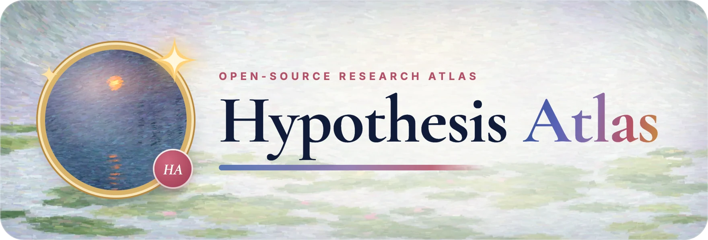
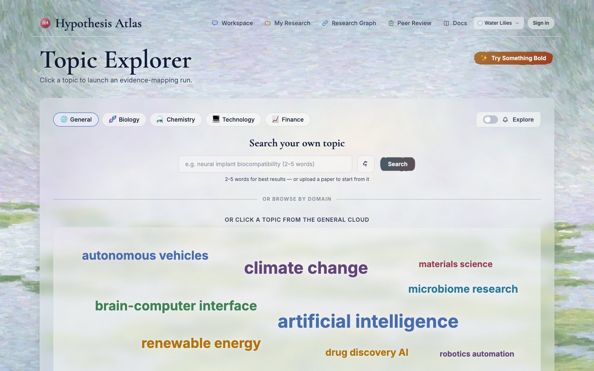
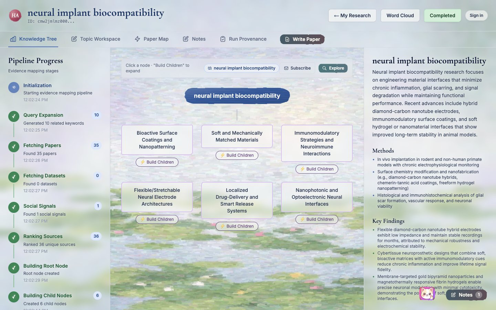
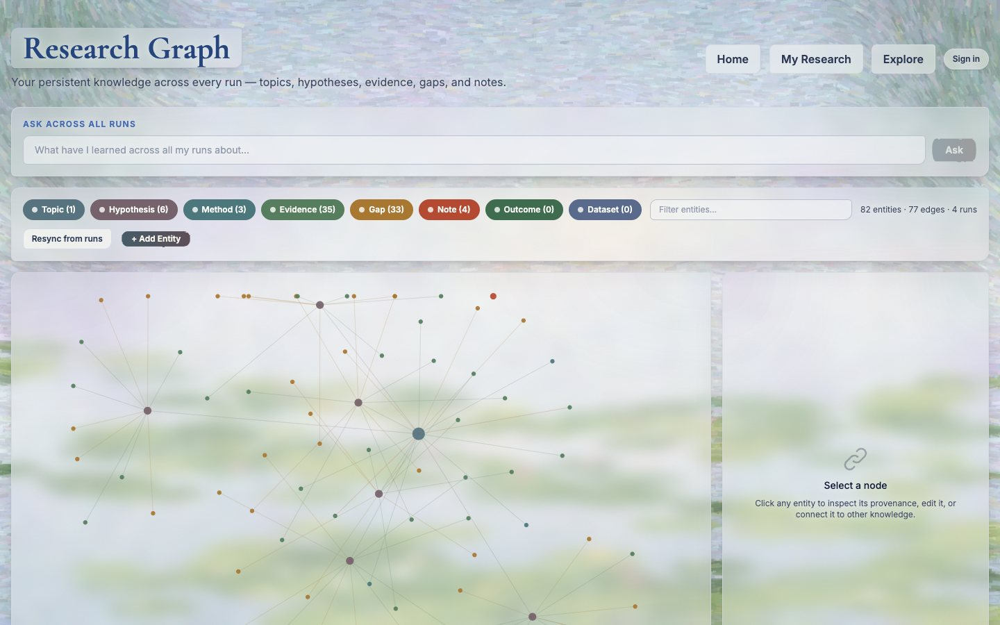
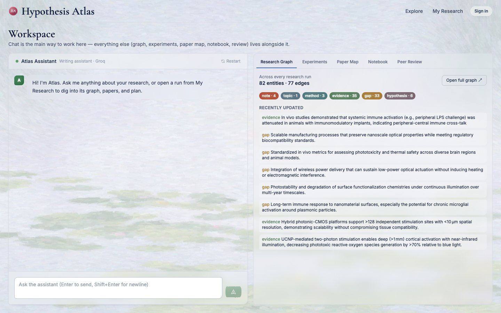
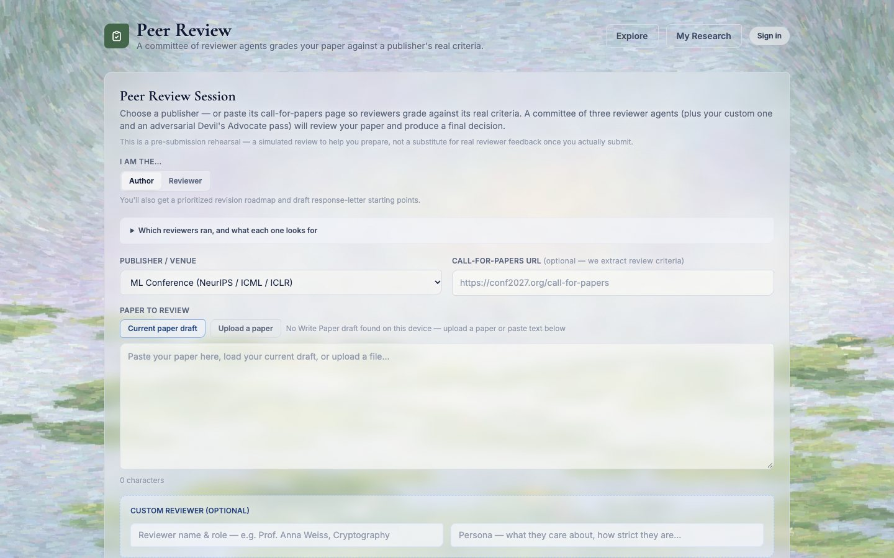
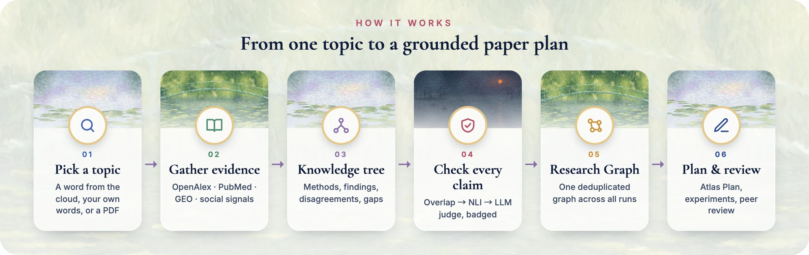

<div align="center">



<h3>Pick a topic. Map the evidence. Write with confidence.</h3>

<p><em>An open-source research atlas that turns one topic into grounded evidence, a living knowledge graph<br />and a paper plan ready for a peer-review rehearsal, for researchers, analysts and students.</em></p>

<p>
  <a href="CHANGELOG.md"></a>
  <a href="LICENSE"></a>
  <a href="#-quick-start"></a>
  <a href="#-configuration"></a>
</p>

<p>
  
  
  
  
  
</p>

<p>
  <a href="#-quick-start">Quick start</a> ·
  <a href="#-features">Features</a> ·
  <a href="#-how-it-works">How it works</a> ·
  <a href="#-configuration">Configuration</a> ·
  <a href="CHANGELOG.md">Changelog</a> ·
  <a href="#-license--support">License &amp; support</a>
</p>

</div>

---

**Hypothesis Atlas** turns a research topic into a living map of the evidence. Pick a word from the cloud and Atlas gathers peer-reviewed papers, datasets and social signals, builds a knowledge tree of methods, findings, disagreements and open problems, and checks every claim against its sources before anything is written. From there it carries the work forward: plan a paper with **Atlas Plan**, design and verify experiments, and rehearse peer review with a committee of reviewer agents. Every run feeds one **persistent Research Graph**, so what you learn accumulates instead of disappearing.

It's free, self-hostable, and **AGPL-3.0**. Bring your own model key (Claude, OpenAI, Gemini, Groq and five more), or run it on the server's.

<p align="center">
  
  <br /><sub><b>Explorer</b>: click any topic to launch an evidence-mapping run, or search your own.</sub>
</p>

## ✨ Why Atlas

- **Grounded, not generated.** Findings are split into single claims and checked against their own sources (text overlap → NLI → LLM judge). A claim that fails is kept and visibly **badged** as unsupported, contradicted or unverified, never quietly dropped.
- **Memory across runs.** The Research Graph deduplicates the same concept found in different runs onto one node, so you can ask *"what have I learned about X across everything?"* and get an answer that cites its sources.
- **Research to paper in one place.** Explore → plan → experiment → review, with your own edits preserved and re-checked, and a plain-Markdown export that works with any editor or agent.
- **Yours to run.** One command with Docker. Accounts are optional on a self-hosted instance, and your data stays on your server.

## 🧭 Features

Everything below ships in **Hypothesis Atlas 1.0**.

<table>
  <tr>
    <td width="50%" valign="top">
      <h4>🗺️ Evidence mapping</h4>
      Word clouds for General, Biology, Chemistry, Technology and Finance, or type a 2–5 word topic. Papers come from <b>OpenAlex</b> and <b>PubMed</b>, datasets from <b>GEO</b>, plus social signals, assembled live into a knowledge tree.
    </td>
    <td width="50%" valign="top">
      <h4>🧠 Persistent Research Graph</h4>
      Every completed run syncs topics, hypotheses, methods, evidence, gaps, outcomes and datasets into one workspace-isolated graph with full editing, cross-run Q&amp;A, and a step-by-step provenance log for every run.
    </td>
  </tr>
  <tr>
    <td valign="top">
      <h4>📝 Paper pipeline with Atlas Plan</h4>
      <b>Setup → Plan → Experiments.</b> Atlas Plan drafts a contribution statement, claims, an evidence map, a method and data plan, threats to validity and an outline, all grounded in your collected sources and editable in place.
    </td>
    <td valign="top">
      <h4>🧑‍⚖️ Peer-review rehearsal</h4>
      A committee of reviewer agents (methodology &amp; novelty, venue fit &amp; impact, statistical rigor), an optional custom reviewer and a Devil's Advocate pass, graded against a venue's real call-for-papers criteria.
    </td>
  </tr>
  <tr>
    <td valign="top">
      <h4>💬 Workspace, notebook &amp; notes</h4>
      A chat-first workspace with the graph, experiments, paper map, notebook and review alongside it. Write in a Markdown notebook with an AI copilot, keep session notes, and converge on your top three ideas.
    </td>
    <td valign="top">
      <h4>🔑 Bring your own model key</h4>
      Anthropic (Claude), OpenAI, Google Gemini, Groq, OpenRouter, Mistral, DeepSeek, xAI or Together AI. The key stays in your browser and is never stored, logged or written to the run log.
    </td>
  </tr>
  <tr>
    <td valign="top">
      <h4>📬 Weekly paper digests</h4>
      Subscribe to any topic for a weekly email of the latest papers from the past two years, ranked by relevance and recency, with one-click unsubscribe.
    </td>
    <td valign="top">
      <h4>🎨 Monet &amp; ink-wash styles</h4>
      Impressionist paintings by default (Water Lilies, The Footbridge, Impression, Sunrise), or switch to ink wash. Both palettes keep the same lightness, so text stays equally readable.
    </td>
  </tr>
  <tr>
    <td valign="top">
      <h4>💡 Bold Idea</h4>
      Type any idea, however unconventional. Agents propose research directions, find papers for each, and a <b>second model critiques them</b> as well-supported, speculative or contradicted, then you design an experiment for the direction you like.
    </td>
    <td valign="top">
      <h4>🎓 Learn as you go</h4>
      Ask <b>Question Cat</b> anything about a run, or switch it to quiz mode. Every knowledge-tree node has its own quiz, and the paper pipeline can test your understanding of the whole run.
    </td>
  </tr>
</table>

<p align="center">
  
  <br /><sub><b>A run's knowledge tree</b>: live pipeline progress, sub-topics you can expand, and each node's methods, findings and open problems.</sub>
</p>

<details>
<summary><b>Evidence mapping, in detail</b></summary>

- Domain selector (General · Biology · Chemistry · Technology · Finance) with a word cloud per domain
- Custom topic search: type 2–5 words and a live keyword cloud is generated around your topic
- **Explore toggle**: clicking a word subscribes you to weekly papers instead of launching a run
- Start from a paper instead: upload a PDF and the run is built from it
- **Node-aware papers**: scope paper fetching to any node in the tree; results show which nodes they connect to
- **Paper Map**: a hub-and-spoke map with the research topic at the centre and weighted links to each paper
- **Paper Compare**: pick two papers to get their methodological differences and a research-gap analysis
- Every node shows its methods, findings, disagreements and open problems

</details>

<details>
<summary><b>Persistent Research Graph, in detail</b></summary>

- **Cross-run graph** at `/graph`: every completed run syncs its topics, hypotheses, methods, evidence, gaps, outcomes and datasets into one graph in PostgreSQL
- **Workspace-isolated**: entities and edges belong to a workspace (your account, or a shared `default` workspace when self-hosted and anonymous), with private / shared / public visibility
- **Deduplicated by design**: entities are keyed by workspace, type and normalized label, so the same concept from different runs converges on one node; `POST /api/graph/dedupe` merges any stragglers (user-created entities always win)
- **Verified before it's written**: findings are sanitized, split into single claims and grounded (overlap → NLI → LLM judge). Claims that fail are written anyway, badged so you can see them
- **Negative results are kept**: record an outcome (result, failure mode, effect, conditions) against a hypothesis. Its status (proposed → grounded → under test → supported / refuted / inconclusive, or abandoned) is computed from its outcomes, and a single refuted outcome outweighs any number of supporting ones
- **Ask across all runs**: answers cite the matched entities, their context and the supporting papers, with key takeaways and open gaps
- **Full editing** with typed relationships: motivates, supports, uses method, contradicts, reveals, tests, uses dataset, derived from, transferred from, replicates and more
- **Provenance**: every entity carries its supporting papers and the exact matched passage. Each run's **Run Provenance** tab logs every prompt, model, seed and tool call, and exports as a reproducibility bundle

</details>

<details>
<summary><b>Paper pipeline, in detail</b></summary>

- **Setup**: pick an idea (from your converged ideas, a tree node or the raw topic) and collect papers (search OpenAlex and PubMed, or import from the Paper Map)
- **Plan**: Atlas Plan drafts everything in one pass, grounded against your collected papers plus the run's own sources
  - Every section is editable and saves automatically
  - An edited claim is marked **"edited – not re-checked"** until you re-check it; re-checking re-grounds just that claim
  - Each claim's badge (grounded / unsupported / contradicted) expands to show the passage it was checked against and which method decided it
  - Attach a `.md` reference document as extra context
  - **Export** a plain-Markdown context file (contribution, claims and their badges, method plan, threats, outline)
- **Experiments**: design an experiment (hypothesis, variables, metrics, expected results) and verify its quantitative claims

</details>

<details>
<summary><b>Peer review, in detail</b></summary>

- A standalone session at `/review`, also available as a panel in the Workspace
- Choose whether you're the **author** (you also get a prioritized revision roadmap and a draft response letter) or a **reviewer**
- Pick a venue, or paste a **call-for-papers URL** so the reviewers grade against its real criteria
- Review your current paper draft, or upload a `.pdf`, `.txt` or `.md`
- A live progress view shows which reviewer is running
- The verdict: averaged 1–10 scores (novelty, soundness, clarity, significance, overall), a consensus recommendation and an editor-style meta-review, plus each reviewer's strengths, weaknesses and questions
- Download the completed review as a report

</details>

<details>
<summary><b>Bold Idea, in detail</b></summary>

- A free-text entry point (**Try Something Bold** on Explorer): no topic list or domain picker
- The idea is tagged with its subjects (which can span several fields), then an explorer agent proposes candidate research directions
- Each direction gets its own literature search, with a method, summary and gap extracted per paper
- An **independent critic from a different model** gives each direction a verdict (well-supported, speculative or contradicted) and writes an overall synthesis: a summary, the biggest gap, and next steps
- Chat about the idea, save highlights as knowledge, and **design an experiment** for any direction
- Ideas started anonymously can be claimed once you sign in; find them later under My Research → Bold Idea

</details>

<details>
<summary><b>Notebook, notes &amp; learning tools, in detail</b></summary>

- **Notebook**: multi-page Markdown with math (KaTeX) rendering, an AI copilot that suggests topics from your conversation, candidate topics to explore next, and **Converge to Top 3** research ideas, exportable as Markdown
- **Session notes**: a session-memory card for each run; ask the assistant to "remember" something and it's saved as a note in the Research Graph
- **Question Cat**: a run's own assistant that answers questions about the topic, the evidence and the papers in the tree, and can switch to a quick quiz
- **Node quizzes**: test yourself on any knowledge-tree node's methods and findings
- **Test Your Understanding**: multiple-choice questions on the paper page, drawn only from the run's knowledge tree (its methods and findings)

</details>

<details>
<summary><b>Accounts &amp; ownership, in detail</b></summary>

- Email and password accounts (bcrypt-hashed), with password reset by emailed one-time link
- **Optional on a self-hosted instance**: everything works without signing in unless you set `REQUIRE_AUTH=true`
- Work done while signed in belongs to you; anonymous work stays open, and you can **claim** it after signing up
- `/account`: profile, usage, and settings (name, password, model key)
- My Research marks entries "Yours" or "Unclaimed" once you're signed in

</details>

<table>
  <tr>
    <td width="50%"></td>
    <td width="50%"></td>
  </tr>
  <tr>
    <td align="center"><sub><b>Research Graph</b>: every run's knowledge in one deduplicated graph.</sub></td>
    <td align="center"><sub><b>Workspace</b>: chat first, with your research alongside.</sub></td>
  </tr>
</table>

<p align="center">
  
  <br /><sub><b>Peer-review rehearsal</b>: grade your draft against a real venue's criteria before you submit.</sub>
</p>

## 🔬 How it works

<p align="center">
  
</p>

Runs are processed by a background **worker** (BullMQ on Redis), so the web app stays responsive. Each step streams its progress to the browser and is recorded in the run's provenance log.

## 🚀 Quick start

**Prerequisites:** Docker. For local development, also Node.js 24 (the version the Docker image uses).

```bash
git clone https://github.com/widsith-ai/hypothesis-atlas.git
cd hypothesis-atlas
```

**🐳 Option A: Docker**, everything in one go

```bash
cp .env.example .env    # add GROQ_API_KEY and NEXTAUTH_SECRET
make image              # build the app image
make run                # Postgres, Redis, the app and the worker
```

Stop it with `make stop`.

**🛠️ Option B: local dev**, with hot reload while you edit

```bash
make laptop-install     # dependencies, .env, Postgres, Redis, database schema
make dev                # terminal 1: the web app
make worker             # terminal 2: the run worker
```

`make laptop-install` creates `.env` for you (with a generated `NEXTAUTH_SECRET`) if you don't have one; add your `GROQ_API_KEY` to it.

Open **http://localhost:3000**. It goes straight to Explorer: click a topic and watch the run build.

<details>
<summary><b>Manual setup without <code>make</code></b></summary>

1. `npm install`
2. Fill in `.env` (see [Configuration](#-configuration))
3. Start Postgres and Redis: `docker compose up -d postgres redis`
4. Create the tables: `npm run db:push`
5. Run `npm run dev` and, in a second terminal, `npm run worker`

</details>

## 🔧 Configuration

Everything is read from `.env`. Only the first block is needed for a working instance; everything else switches on an extra feature.

| Variable | | What it does |
|---|---|---|
| `DATABASE_URL` | **required** | PostgreSQL connection string |
| `REDIS_URL` | **required** | Redis, for the run queue |
| `GROQ_API_KEY` | **required**¹ | The server's default model, used by runs, planning, review and chat |
| `NEXTAUTH_SECRET` | **required** | Signs sessions. Generate with `openssl rand -base64 32` |
| `NEXTAUTH_URL` | **required** | The app's public URL, e.g. `http://localhost:3000` |
| `ANTHROPIC_API_KEY` | optional | Paper Compare |
| `OPENAI_API_KEY` | optional | The independent critic in Bold Idea explorations |
| `RESEND_API_KEY` | optional | Sends weekly digests and password-reset emails |
| `EMAIL_FROM` | optional | Sender address for those emails (default: Resend's test sender) |
| `NEXT_PUBLIC_APP_URL` | optional | Base URL used in email links |
| `CRON_SECRET` | optional | Protects the weekly-digest cron endpoint |
| `NEO4J_URI`, `NEO4J_USERNAME`, `NEO4J_PASSWORD`, `NEO4J_DATABASE` | optional | Neo4j paper graph behind the Paper Map; without it those graph features are off |
| `REVIEW_NLI_ENDPOINT`, `REVIEW_NLI_AUTH_TOKEN`, `REVIEW_NLI_MODEL` | optional | An NLI service for claim grounding (default model `deberta-v3-large-mnli`); without it, grounding uses overlap and the LLM judge |
| `REQUIRE_AUTH` | optional | `true` requires an account before starting research. Unset (the default), accounts are optional |
| `ATLAS_EDITION` | optional | `self-hosted` (default) or `hosted`. Self-hosted users are never asked for a model key when the server has one |

¹ Or have users bring their own key: with no server key, Atlas asks each person for one when they start.

> [!TIP]
> **Bring your own model key.** Anyone can switch the AI features to their own provider under **Account → Settings → Model & API key** (also in the account menu when the server has no key of its own). The key lives only in their browser (`sessionStorage`, or `localStorage` with "Remember on this device"), is sent only with this app's own `/api/*` requests, and is used for that request alone. Background runs use the server's key.

## 🧱 Architecture

| Layer | Technology |
|---|---|
| Web app | **Next.js 14** (App Router), React 18, TypeScript, Tailwind CSS |
| Data | **PostgreSQL 15** via Prisma: runs, sources, the Research Graph, accounts |
| Queue & worker | **Redis 7** + BullMQ; a separate Node worker (`npm run worker`) executes runs |
| Models | Groq by default; Anthropic, OpenAI, Gemini, OpenRouter, Mistral, DeepSeek, xAI and Together via bring-your-own-key |
| Sources | OpenAlex, PubMed (NCBI E-utilities), GEO, social signals |
| Auth & email | NextAuth (credentials), bcrypt; Resend |
| Optional | Neo4j (paper graph), an NLI service (claim grounding) |
| Tests | Vitest, 400+ tests (`npm test`) |

<details>
<summary><b>Project layout</b></summary>

```
src/
  app/              Next.js routes: pages and /api handlers
    explore/        the word cloud (where / goes)
    job/[id]/       a run: knowledge tree, workspace, paper map, notes, provenance
    graph/          the persistent Research Graph
    workspace/      chat-first workspace with side panels
    review/         peer-review rehearsal
    api/            REST endpoints (jobs, graph, review, auth, llm, …)
  components/       UI (AuthWidget, ModelKeySettings, PaperReviewPanel, …)
  lib/              domain logic: llm.ts, review-grounding.ts, research-graph.ts, apis/, …
  worker/           the BullMQ run processor
prisma/             database schema
public/monet/       the generated Impressionist backgrounds
scripts/            setup and asset-generation scripts
ee/                 reserved for source-available enterprise modules (see ee/README.md)
```

</details>

## 📦 Deployment

**One machine:** `make image && make run` is a complete deployment: Postgres, Redis, the app and the worker, all in Docker. Set `NEXTAUTH_URL` to your domain.

**Managed services:** the web app on Vercel (with `NEXTAUTH_SECRET` and `NEXTAUTH_URL` set), the worker on Railway or Render (`npm run worker`), managed PostgreSQL (Neon, Supabase), and managed Redis (Upstash). Create the tables once with `DATABASE_URL="…" npm run db:push`; skipping this after a fresh deploy shows up as a generic "server configuration" error at sign-in.

## 🧪 Development

```bash
npm test             # the Vitest suite
npx tsc --noEmit     # type-check
npm run db:studio    # browse the database
```

Reset the local database: `docker compose down -v && docker compose up -d postgres redis && npm run db:push`

## 🙏 Acknowledgments and prior art

Atlas's review and planning are original implementations. The projects below informed the design; no code or prompts are copied.

| Project | What it informed | License |
|---|---|---|
| Academic Research Skills (Cheng-I Wu) | Paper-planning design; Atlas Plan is an original implementation | CC-BY-NC 4.0 |
| [poldrack/ai-peer-review](https://github.com/poldrack/ai-peer-review) | Multiple independent reviewers plus a meta-review | MIT |
| [FanBroWell/AI-paper-reviewer](https://github.com/FanBroWell/AI-paper-reviewer) | Pre-submission checks on claims, experiments and citations | MIT |
| [JShi12/AI-literature-review-assistant](https://github.com/JShi12/AI-literature-review-assistant) | Citations tied to source passages | MIT |
| [The AI Scientist](https://arxiv.org/abs/2408.06292) (Lu et al., 2024) | Automated review and benchmarking reviews against ICLR | AI Scientist Source Code License |
| [SelfCheckGPT](https://arxiv.org/abs/2303.08896) (Manakul et al., EMNLP 2023) | Self-consistency for hallucination detection (`applySelfConsistency`) | MIT |
| [MiniCheck](https://arxiv.org/abs/2404.10774) (Tang et al., EMNLP 2024) | Checking claims against grounding documents | Apache-2.0 |
| [DeBERTa-v3 NLI](https://huggingface.co/MoritzLaurer/DeBERTa-v3-large-mnli-fever-anli-ling-wanli) | The default entailment model in `review-grounding.ts` | Check the model card |

If code is ever copied from an MIT or Apache project, its license notice will be listed in `THIRD_PARTY_NOTICES.md`.

## 📜 License & support

**Hypothesis Atlas is free and open source** under the [GNU AGPL-3.0](LICENSE). Use it, self-host it, change it. If you offer a modified version as a network service, AGPL-3.0 asks you to share that version's source with its users.

**Working with us.** For a **research collaboration**, an **enterprise or on-premises deployment**, or a **[commercial license](COMMERCIAL-LICENSE.md)** without AGPL's source-sharing obligations, email **[hello@hypothesisatlas.com](mailto:hello@hypothesisatlas.com)**. The hosted product is developed separately.

- Pre-1.0 development releases are kept on the [`version-history`](https://github.com/widsith-ai/hypothesis-atlas/tree/version-history) branch, under the licenses they were published with (MIT before `v3.2.0`; Academic Research Skills attribution, CC-BY-NC 4.0, where that code was integrated).
- `ee/` is reserved for source-available enterprise modules under the [Widsith Enterprise License](ee/LICENSE.md) (draft). The core outside `ee/` stays AGPL-3.0, and core features will never move behind a paywall.

## 🤝 Contributing

Contributions are welcome. See [`CONTRIBUTING.md`](CONTRIBUTING.md); commits need a DCO `Signed-off-by:` line. Report security issues privately as described in [`SECURITY.md`](SECURITY.md).

<div align="center">
<sub>Made with care for researchers · <a href="CHANGELOG.md">Changelog</a> · <a href="https://github.com/widsith-ai/hypothesis-atlas/issues">Issues</a></sub>
</div>
